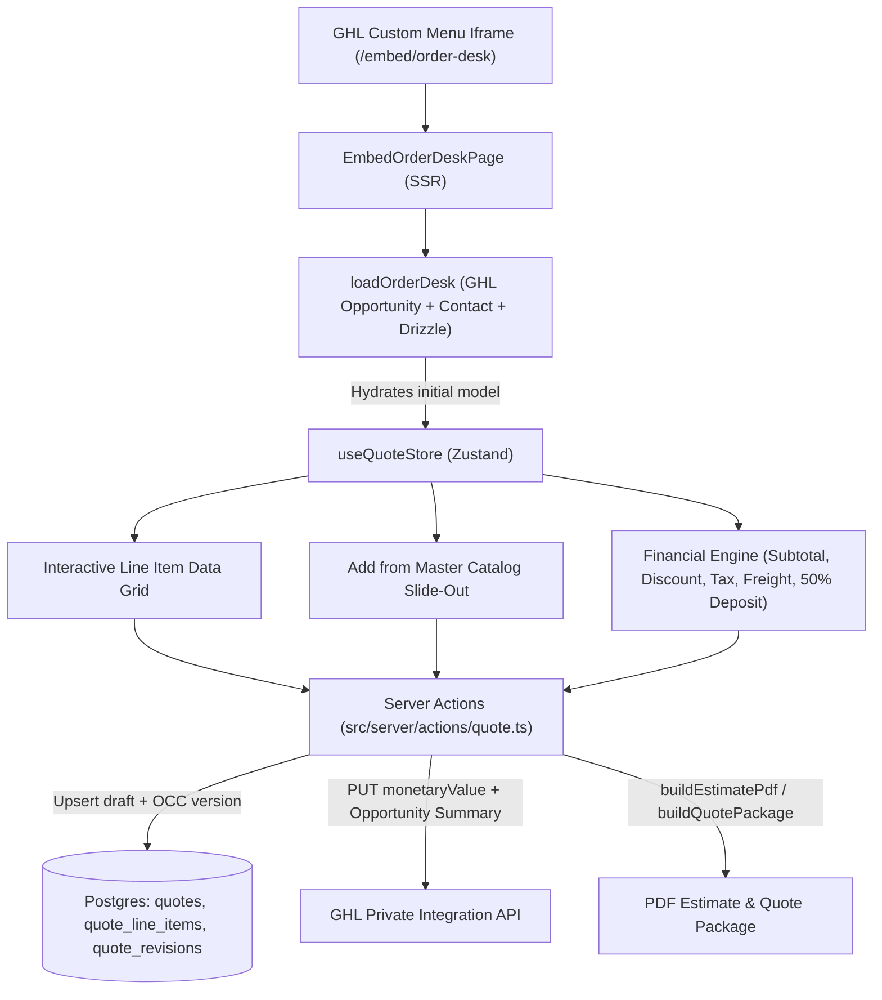

# GHL Order Desk Quoting Engine Build Plan

## Phase 1: Codebase Discovery Summary

- **Routing & Embeds (`[src/app/embed/order-desk/page.tsx](src/app/embed/order-desk/page.tsx)` & `[src/lib/embed-actor-params.ts](src/lib/embed-actor-params.ts)`)**:
  - Parses `opportunityId`, `quoteId`, `ghlUserId`, and `ghlUserEmail` from SSR `searchParams` and client URL `search` / `hash` parameters.
  - Extend `[src/lib/embed-actor-params.ts](src/lib/embed-actor-params.ts)` to also parse `contactId` (`contactid`, `contact_id`) and `locationId` (`locationid`, `location_id`) from the GHL Custom Menu Link iframe URL.
- **Database Schema (`[src/server/db/schema.ts](src/server/db/schema.ts)` & `[src/server/db/migrations/0036_quote_customer_financials.sql](src/server/db/migrations/0036_quote_customer_financials.sql)`)**:
  - `quotes`: Stores opportunity/contact metadata, `customer_name`, `customer_email`, `bill_to_address`, `ship_to_address`, `merchandise_total`, `discount_amount`, `discount_type` (`FLAT` | `PERCENTAGE`), `tax_amount`, `freight_method`, `freight_total`, `deposit_pct` (defaults to `50.00` via `logistics_settings`), and OCC `version`. Note that migration `0036_quote_customer_financials.sql` added these columns directly onto `quotes` rather than a separate table.
  - `quote_line_items`: Stores `line_no`, `line_kind` (`stock_hold` | `configured` | `custom`), `sku`, `katana_variant_id`, `qty`, `unit_price`, `description`, `inventory_hold_id`, and logistics dimensions (`weight_lb`, `ltl_class`, `length_in`, `width_in`).
  - `inventory_holds`: Tracks active 14-day showroom holds (`status = 'active'`) tied to `ghl_opportunity_id`.
- **State & GHL Integrations (`[src/server/quotes/load-order-desk.ts](src/server/quotes/load-order-desk.ts)`, `[src/server/ghl/private-api.ts](src/server/ghl/private-api.ts)`, `[src/server/quotes/send-quote.ts](src/server/quotes/send-quote.ts)`)**:
  - Currently `OrderDeskPortal.tsx` uses local `useState` hooks, lacks a Master Catalog slide-out to add `configured` catalog SKUs, lacks inline editing for line `qty`, `description`, and `unit_price`, and does not display the 50% required deposit & balance due in the financial summary.

## Architecture & Data Flow

## Phase 2: Step-by-Step Implementation Plan

### Step 1: GHL URL Parameter Parsing & Contact Hydration

- Update `[src/lib/embed-actor-params.ts](src/lib/embed-actor-params.ts)` to extract `contactId` and `locationId` alongside `opportunityId`, `quoteId`, `ghlUserId`, and `ghlUserEmail`.
- Enhance `[src/server/quotes/load-order-desk.ts](src/server/quotes/load-order-desk.ts)` and `[src/server/quotes/draft.ts](src/server/quotes/draft.ts)`:
  - Fetch GHL Contact details (`/contacts/:contactId`) when hydrating an opportunity so `customer_name`, `customer_email`, `bill_to_address`, and `ship_to_address` pre-populate on new drafts.
  - Automatically attach any active `inventory_holds` on the opportunity as `stock_hold` line items on draft creation, and provide one-click attachment for holds created after draft initialization.
  - Expose `depositPct` on `OrderDeskQuote` in `[src/server/quotes/view.ts](src/server/quotes/view.ts)` (defaulting to `"50.00"`).

### Step 2: Zustand Quote Store (`[src/store/useQuoteStore.ts](src/store/useQuoteStore.ts)`)

- Create `[src/store/useQuoteStore.ts](src/store/useQuoteStore.ts)` to manage:
  - Hydrated `OrderDeskModel` state, `dirty` tracking, and OCC `version`.
  - Inline line-item mutations: `updateLineQty`, `updateLineDescription`, `updateLineUnitPrice` (manual price override), `addCatalogLineDraft`, `removeLineDraft`.
  - Commercial header inputs: `customerName`, `customerEmail`, `billToAddress`, `shipToAddress`, `destZip`, `executedBy`, `discountAmount`, `discountType` (`FLAT` | `PERCENTAGE`), `taxAmount`, and `depositPct` (default `50`).
  - UI modal/drawer states: Master Catalog slide-out (`catalogOpen`, `catalogQuery`, `catalogResults`), Custom Line drawer, and Hold Swap/Remove confirmation dialogs.
  - Derived financial selector computing `subtotal`, `discountDollars`, `tax`, `shipping`, `grandTotal`, `depositRequired`, and `balanceDue`.

### Step 3: Drizzle Server Actions (`[src/server/actions/quote.ts](src/server/actions/quote.ts)`)

- Create `[src/server/actions/quote.ts](src/server/actions/quote.ts)` (and re-export/bridge with `[src/server/actions/order-desk.ts](src/server/actions/order-desk.ts)` so all existing tests continue passing):
  - `upsertQuoteDraft`: Validates session + actor, verifies OCC `version`, updates `quotes` commercial/financial columns, upserts `quote_line_items` (supporting inline edits to `qty`, `description`, `unit_price`, and newly added `configured` catalog lines with `logistics_profiles` lookup), and recalculates `merchandise_total`.
  - `addCatalogQuoteLine`: Adds a Master Catalog SKU (`line_kind: "configured"`) with `katana_variant_id`, MSRP snapshot, and `logistics_profiles` dimensions/weight.
  - `attachUnlinkedHolds`: Attaches any active `inventory_holds` in `suggestions` onto the draft quote as `stock_hold` lines.
  - `finalizeAndSyncQuoteToGhl`: Freezes the quote revision (`freezeQuote`), pushes `monetaryValue` (Grand Total) via `PUT /opportunities/:id`, and writes the itemized CPQ quote summary (lines, discount, tax, freight, grand total, and 50% required deposit) to the GHL Opportunity custom field (`GHL_OPPORTUNITY_BUILD_SUMMARY_FIELD_ID`) or Contact Note fallback.
  - `generateEstimatePdfAction`: Saves any pending draft edits and triggers `generateQuotePdf` / `buildEstimatePdf`.

### Step 4: Interactive Quoting UI (`[src/app/embed/order-desk/page.tsx](src/app/embed/order-desk/page.tsx)` & `[src/app/embed/order-desk/OrderDeskPortal.tsx](src/app/embed/order-desk/OrderDeskPortal.tsx)`)

- Update `[src/app/embed/order-desk/page.tsx](src/app/embed/order-desk/page.tsx)` to pass `contactId` and `locationId` context into `loadOrderDesk` and `OrderDeskPortal`.
- Upgrade `[src/app/embed/order-desk/OrderDeskPortal.tsx](src/app/embed/order-desk/OrderDeskPortal.tsx)`:
  - Bind state to `useQuoteStore` while preserving all existing `data-testid` attributes required by Playwright E2E tests (`order-desk-draft`, `order-desk-lines`, `order-desk-subtotal`, `order-desk-discount`, `order-desk-tax`, `order-desk-shipping`, `order-desk-grand-total`, `order-desk-download-pdf`, `order-desk-download-estimate`, `order-desk-send`, etc.).
  - Render a responsive, full-width CPQ data grid for line items with inline editing for **Quantity**, **Description**, and **Unit Price** (with a visual badge when overridden from catalog MSRP), plus **Extended Line Total**.
  - Build the **"Add from Master Catalog"** slide-out drawer allowing showroom reps to search active finished goods SKUs, set quantity, and push `configured` lines directly to the quote.
  - Enhance the **Financial Summary** sidebar with real-time Subtotal, Global Discount (`%` / `$`), Sales Tax, Freight/Shipping, Grand Total, **Required Deposit (50% default)**, and **Remaining Balance**, plus **"Generate PDF Estimate"** (`Estimate only` & `Download Quote Package`) and **"Freeze & Send Proposal"**.