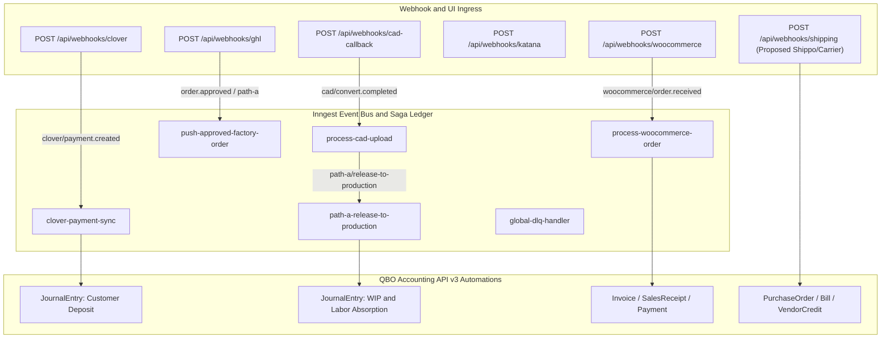

# QuickBooks Online (QBO) Accounting API Architectural Analysis & Automation Blueprint

## Phase 1: Codebase Discovery & Data Flow Audit

### 1.1 Event Bus & Saga Topology

The MDM Hub (`ccpatio-middleware`, Next.js `16.3.2` in [package.json](package.json)) orchestrates manufacturing, commercial quoting, e-commerce, and accounting across 13 registered Inngest functions in [src/inngest/functions.ts](src/inngest/functions.ts) and 4 core webhook ingress routes:



### 1.2 Sales & CPQ Pipelines (Path A vs. Path B)

- **Path A (Showroom / Custom Design & GHL Factory Lane)**:
  - **Intake**: [src/app/api/webhooks/ghl/route.ts](src/app/api/webhooks/ghl/route.ts) verifies `GHL_WEBHOOK_SECRET`, handles `lost`/`abandoned` hold releases via `releaseHold`, and filters for `Produce Factory Order` (`PRODUCE_FACTORY_ORDER_STAGE` / `GHL_FACTORY_STAGE_IDS` in [src/server/ghl/factory-stage.ts](src/server/ghl/factory-stage.ts)) to insert rows into `order_intake`.
  - **Commercial Quoting**: [src/server/db/schema.ts](src/server/db/schema.ts) (`quotes`, `quote_line_items`, `quote_revisions`, `quote_overrides`) and [src/lib/quote-financials.ts](src/lib/quote-financials.ts) compute integer-rounded subtotals, flat/percentage discounts, tax, freight, and deposit percentages (`deposit_pct`, default `50.00%`).
  - **Custom CAD Loop**: `processCadUpload` ([src/inngest/functions.ts](src/inngest/functions.ts)) and [src/inngest/cad-handoff.ts](src/inngest/cad-handoff.ts) dispatch `.blend` conversions to the headless Python/Blender service and await `cad/convert.completed` via `step.waitForEvent("wait-cad-callback")` before advancing `saga_runs` (`saga_type = "path_a_cad"`) to `AWAITING_DEPOSIT`.
  - **Stateless Production Release**: `pathAReleaseToProduction` ([src/inngest/path-a-release.ts](src/inngest/path-a-release.ts)) claims the saga atomically (`claimRelease`), verifies `factory_release_gate.dossier_hash`, syncs BOM recipes to Katana behind `CATALOG_PUBLISH_MODE`, creates one Katana Sales Order (`PA-<ghlOpportunityId>`), creates per-item MOs with signed `/factory/cut-cards/[token]` URLs, and emits `path-a/release.completed` and `path-a/ghl.sync.requested`.
  - **Standard GHL Factory Order Push**: `pushApprovedFactoryOrder` ([src/server/ghl/push-factory-order.ts](src/server/ghl/push-factory-order.ts)) listens to `order.approved`, converts `inventory_holds` (`HOLD-` dummy Katana SOs) into production SOs (`GHL-<opportunityId>`), creates MOs, and binds customer fabric variants (`bindMtoFabric`).
- **Path B (WooCommerce / VividWorks 3D CPQ)**:
  - **Ingress & Baseline Pinning**: [src/app/api/webhooks/woocommerce/route.ts](src/app/api/webhooks/woocommerce/route.ts) verifies HMAC-SHA256 (`x-wc-webhook-signature`), classifies order state (`paid`, `awaiting_payment`, `terminal_after_paid_needs_human`), pins a cryptographic order fingerprint (`decidePaidDelivery` in [src/server/woocommerce/paid-baseline.ts](src/server/woocommerce/paid-baseline.ts)) to quarantine post-payment edits (`post_payment_edit`), validates SKUs/finishes against the hub DB ([src/server/woocommerce/sku-resolver.ts](src/server/woocommerce/sku-resolver.ts)), and emits `woocommerce/order.received`.
  - **Saga Execution**: `processWooCommerceOrder` ([src/inngest/woo-order.ts](src/inngest/woo-order.ts)) creates Katana Sales Order `WOO-<orderId>`, creates MTO Manufacturing Orders per line, swaps generic finish placeholders (`frame`, `powder_coat`, `fabric`) via `bindPlaceholder`, and invokes the ledger seam [src/server/woocommerce/ledger-leg.ts](src/server/woocommerce/ledger-leg.ts) (currently parked at `awaiting_ledger_step_8` when `LEDGER_PIPELINE_MODE=live`).

### 1.3 Fulfillment, CRM & Freight Architecture

- **GHL Stage & Hold Lifecycle**:
  - While legacy architecture referenced `GHL_STAGE_FULFILLMENT_ALLOCATING`, the active codebase implements stage gating in [src/server/ghl/factory-stage.ts](src/server/ghl/factory-stage.ts) (`PRODUCE_FACTORY_ORDER_STAGE`, `GHL_FACTORY_STAGE_IDS`, `GHL_WON_STAGE_IDS`) and writes build summaries back to GHL via `pathAGhlSync` ([src/inngest/path-a-ghl-sync.ts](src/inngest/path-a-ghl-sync.ts)).
  - Showroom holds (`inventory_holds` in [src/server/db/schema.ts](src/server/db/schema.ts)) reserve stock via `HOLD-` Katana sales orders and are swept by `sweepExpiredInventoryHolds`, `sendHoldExpirationWarnings`, and `autoReleaseExpiredHolds`.
- **Freight & Shipping Engine (Priority1, FedEx Freight, Internal Fleet, and Shippo Gap)**:
  - Active LTL and fleet rating lives in [src/server/freight/fulfillment.ts](src/server/freight/fulfillment.ts), [src/server/freight/priority1.ts](src/server/freight/priority1.ts), [src/server/freight/fedex-carrier.ts](src/server/freight/fedex-carrier.ts), and [src/lib/freight/fedex-freight.ts](src/lib/freight/fedex-freight.ts), caching carrier rate plans in `freight_rate_cache` and persisting selected carrier quotes (`brokerTotalUsd` vs. marked-up `customerTotalUsd` using `ltl_handling_markup_pct`) in `quotes.freight_snapshot`.
  - **Audit Finding on Shippo / `/api/webhooks/shipping`**: There is currently **no** `/api/webhooks/shipping` route and no `QBO_VENDOR_ID_SHIPPO` binding in `src/`. Parcel/label webhook ingestion (`transaction_created`, `transaction_updated`, `track_updated`) and LTL bill of lading (BOL) invoice capture are greenfield webhook endpoints ready to be wired into the Inngest bus.

### 1.4 Manufacturing & Factory BOM Wizard

- **Step 1 (`Step1Cad.tsx`)**: [src/app/embed/factory-bom/steps/Step1Cad.tsx](src/app/embed/factory-bom/steps/Step1Cad.tsx) manages `.dae`/`.glb` 3D geometry snapshots, `GEOM_HYGIENE` validation, client PDF factory packets, and 3-slot finish selection (`frame`, `powder`, `fabric`).
- **Step 2 (`Step2Materials.tsx`)**: [src/app/embed/factory-bom/steps/Step2Materials.tsx](src/app/embed/factory-bom/steps/Step2Materials.tsx) renders `product_bom_draft` cut cards (`cut_list` JSONB with profile, length, mitre angles) and secondary extraction physics (`argon` cf, `sand` lbs, `aluminumLbs`, and freight packaging `skidBoardFt`, `strapFt`, `shrinkSqft` from [src/lib/secondary-extraction/packaging.ts](src/lib/secondary-extraction/packaging.ts) and `RM-PKG-CORRUGATE`, `RM-PKG-EDGE-BOARD`, `RM-PKG-STRETCH`).
- **Step 3 (`Step3Operations.tsx`)**: [src/app/embed/factory-bom/steps/Step3Operations.tsx](src/app/embed/factory-bom/steps/Step3Operations.tsx) assigns `item_operations_draft` across locked Katana physical work centers ([src/lib/factory-routing/resources.ts](src/lib/factory-routing/resources.ts): `Metal Cutting`, `FAB POD A/B/C`, `Sandblasting`, `Powder Coating Booth`, `Curing Oven`, `Fabric Cutting`, `Fabric Sewing`, `Cushion Stuffing`, `Quality Control`, `Assembly & Packaging`, `Dekton Fabrication`) using Industrial Engineering SMV baselines ([src/lib/factory-routing/smv-baselines.ts](src/lib/factory-routing/smv-baselines.ts)) and `cushion_fulfillment_mode` (`standard` vs. `vacuum_compressed` +15 mins).
- **Step 4 (`Step4Release.tsx`)**: [src/app/embed/factory-bom/steps/Step4Release.tsx](src/app/embed/factory-bom/steps/Step4Release.tsx) runs `evaluateAirlock` ([src/server/factory-bom/evaluate-airlock.ts](src/server/factory-bom/evaluate-airlock.ts)) and either marks a custom Path A item `finalized` (storing `finalized_dossier_hash`) or publishes catalog recipes to Katana via `publishRecipeToKatanaCore` ([src/server/factory-bom/publish-recipe-katana.ts](src/server/factory-bom/publish-recipe-katana.ts)).

### 1.5 Existing QBO Infrastructure & Bindings Audit

- **OAuth & Mutex Refresh**:
  - [src/app/api/auth/qbo/callback/route.ts](src/app/api/auth/qbo/callback/route.ts) exchanges authorization codes and stores `realm_id`, `access_token`, `refresh_token`, and `expires_at` in `qbo_auth_tokens` (keyed by boolean `id`: `true` = production, `false` = sandbox).
  - [src/server/integrations/qbo/token-refresh.ts](src/server/integrations/qbo/token-refresh.ts) enforces single-writer token refresh using a dedicated `max: 1` transaction-pooler connection (`getMutexDb()` in [src/server/db/client.ts](src/server/db/client.ts)) and two-key transaction-scoped Postgres advisory locks (`pg_advisory_xact_lock(k1, k2)` under namespace `ccpatio:qbo_token_refresh`).
  - Note: While `vendor_credentials` ([src/utils/vault.ts](src/utils/vault.ts)) stores tokens for `katana`, `woocommerce`, and `clover`, QBO tokens live in `qbo_auth_tokens` with RLS enabled (`0053_rls_qbo_tokens_incoming_webhooks.sql`).
- **Ledger Translator & Triage Tables (Phase 14)**:
  - [src/server/ledger/customer-deposit.ts](src/server/ledger/customer-deposit.ts) is a pure integer-cent translator (`toQboAmount`, `qboAmountToCents`, `assertJournalEntryBalanced`) that converts Clover payments attached to approved GHL quotes (`GHL-<opportunityId>`) into balanced QBO `JournalEntry` payloads:
    - **Debit**: `QBO_GATEWAY_CLEARING_ACCOUNT_ID`
    - **Credit**: `QBO_CUSTOMER_DEPOSIT_ACCOUNT_ID` (with `EntityRef` bound to `qboCustomerId`)
  - Persistence tables `pos_receipts` and `ledger_triage` ([src/server/db/schema.ts](src/server/db/schema.ts), migrations `0056_pos_receipts.sql` and `0056_ledger_triage.sql`) track every Clover payment and route exceptions (`quote_ref_invalid`, `quote_not_approved`, `customer_unresolved`, `qbo_rejected`, etc.) to human triage.
- **Disconnects & Legacy Gaps Identified in Codebase**:
  - [src/inngest/clover-sync.ts](src/inngest/clover-sync.ts) still contains legacy `TODO(step-8)` code calling `pushToQBO` ([src/server/integrations/qbo/client.ts](src/server/integrations/qbo/client.ts)) which posts a `SalesReceipt` with `CustomerRef: { value: "1" }` instead of invoking `buildCustomerDepositEntry` from [src/server/ledger/customer-deposit.ts](src/server/ledger/customer-deposit.ts) and persisting to `pos_receipts` / `ledger_triage`.
  - [src/server/db/schema.ts](src/server/db/schema.ts) defines `sku_mappings.qbo_item_id`, `sku_mappings.qbo_accounts` (`{ income, cogs, asset, class }` — e.g. `85 Sales of Product Income`), and `finished_goods_catalog.qbo_item_code`, but `publishApprovedProduct` ([src/inngest/functions.ts](src/inngest/functions.ts)) only fans out to Katana, WooCommerce, and Clover (`channelSyncChannelEnum` lacks `"qbo"`).
  - [src/lib/qbo-queue.ts](src/lib/qbo-queue.ts) is an unused in-memory mock queue that should be superseded by Inngest step workflows.

---

## Phase 2 & 3: Comprehensive QBO Capability Mapping & Executive Report

### Category A: Accounts Receivable (A/R), Revenue Recognition & Clearing Reconciliation

#### Automation A1: Clover POS Capital Event -> QBO Customer Deposit JournalEntry (Wire Phase 14 Core into `clover-payment-sync`)

- **Business Trigger**: Customer pays a 50% custom build or quote deposit via Clover POS (`clover/payment.created`).
- **Inngest Trigger Event**: `clover/payment.created` (handled in [src/inngest/clover-sync.ts](src/inngest/clover-sync.ts)).
- **QBO API Endpoints**:
  - Customer Lookup: `GET /v3/company/{realmId}/query?query=SELECT * FROM Customer WHERE PrimaryEmailAddr = '{email}'`
  - Customer Auto-Create (if missing): `POST /v3/company/{realmId}/customer?requestid={reqId}`
  - Deposit Recognition: `POST /v3/company/{realmId}/journalentry?requestid={reqId}`
- **Data Mapping & Payload Specification**:
  - Uses [src/server/ledger/customer-deposit.ts](src/server/ledger/customer-deposit.ts) (`buildCustomerDepositEntry`) and writes state to `pos_receipts` and `ledger_triage`.

```json
{
  "TxnDate": "2026-10-21",
  "PrivateNote": "Customer deposit | Quote GHL-opp_98765 | Clover payment ABC123XYZ | Clover order ORD456 | Merchant M1",
  "Line": [
    {
      "Description": "Customer deposit GHL-opp_98765",
      "Amount": 2500.00,
      "DetailType": "JournalEntryLineDetail",
      "JournalEntryLineDetail": {
        "PostingType": "Debit",
        "AccountRef": { "value": "${QBO_GATEWAY_CLEARING_ACCOUNT_ID}" }
      }
    },
    {
      "Description": "Customer deposit GHL-opp_98765",
      "Amount": 2500.00,
      "DetailType": "JournalEntryLineDetail",
      "JournalEntryLineDetail": {
        "PostingType": "Credit",
        "AccountRef": { "value": "${QBO_CUSTOMER_DEPOSIT_ACCOUNT_ID}" },
        "Entity": {
          "Type": "Customer",
          "EntityRef": { "value": "482" }
        }
      }
    }
  ]
}
```

#### Automation A2: Path B WooCommerce Paid Order -> QBO Deferred Deposit or Invoice + Payment (Step 8 Ledger Leg)

- **Business Trigger**: Paid WooCommerce order completes Katana SO/MO creation in `processWooCommerceOrder` ([src/inngest/woo-order.ts](src/inngest/woo-order.ts)) and reaches `runWooLedgerLeg` ([src/server/woocommerce/ledger-leg.ts](src/server/woocommerce/ledger-leg.ts)).
- **Inngest Trigger Event**: Step `ledger-leg` inside `woocommerce/order.received` (or emitted child event `qbo/woo-order.ledger.requested`).
- **QBO API Endpoints**:
  - `POST /v3/company/{realmId}/journalentry?requestid={reqId}` (for GAAP Deferred Revenue on MTO builds at order intake)
  - `POST /v3/company/{realmId}/invoice?requestid={reqId}` + `POST /v3/company/{realmId}/payment?requestid={reqId}` (upon fulfillment/delivery to recognize `85 Sales of Product Income`, shipping income, and sales tax liability).
- **Data Mapping & Payload Specification**:
  - Maps `order.billing.email` -> QBO `CustomerRef`, `sku_mappings.qbo_item_id` -> `SalesItemLineDetail.ItemRef`, `order.shipping_total` -> Freight Income Item, `order.total_tax` -> `TxnTaxDetail`, and injects integer-cent rounding variance (if any) to `QBO_ROUNDING_CLEARING_ACCOUNT_ID`.

```json
{
  "DocNumber": "WOO-10492",
  "TxnDate": "2026-10-21",
  "CustomerRef": { "value": "519" },
  "PrivateNote": "WooCommerce Order 10492 | Katana SO WOO-10492",
  "Line": [
    {
      "DetailType": "SalesItemLineDetail",
      "Amount": 3499.00,
      "Description": "FIN-OCN-CLUB-TJM | Frame: FRM-ALUM | Powder: PWD-BLK | Fabric: FAB-SUN-5404",
      "SalesItemLineDetail": {
        "ItemRef": { "value": "104", "name": "FIN-OCN-CLUB-TJM" },
        "Qty": 2,
        "UnitPrice": 1749.50
      }
    },
    {
      "DetailType": "SalesItemLineDetail",
      "Amount": 285.00,
      "Description": "LTL Freight (Priority1 / FedEx Freight)",
      "SalesItemLineDetail": {
        "ItemRef": { "value": "${QBO_FREIGHT_ITEM_ID}" },
        "Qty": 1,
        "UnitPrice": 285.00
      }
    }
  ],
  "TxnTaxDetail": {
    "TotalTax": 302.72
  }
}
```

#### Automation A3: Path A Quote Approval & Final Delivery -> QBO Commercial Invoice & Deposit Application

- **Business Trigger**: When a quote in `quotes` / `quote_revisions` ([src/server/db/schema.ts](src/server/db/schema.ts)) transitions to `converted` / `paid` or Katana Sales Order `PA-<oppId>` / `GHL-<oppId>` is marked `DELIVERED`.
- **Inngest Trigger Event**: `quote/revision.sent`, `path-a/release.completed`, or Katana webhook `sales_order.delivered`.
- **QBO API Endpoint**: `POST /v3/company/{realmId}/invoice?requestid={reqId}`
- **Data Mapping & Payload Specification**:
  - Maps `quote_line_items` (`sku`, `qty`, `unit_price`, `description`), `quotes.discount_amount` (`DiscountLineDetail`), `quotes.freight_total`, `quotes.tax_amount`, and applies the liability balance from `QBO_CUSTOMER_DEPOSIT_ACCOUNT_ID` via a negative/credit line item linked to the unearned deposit item so only the remaining 50% balance is due on the QBO Invoice.

#### Automation A4: Gateway Settlement & Merchant Fee Reconciliation (Clover / WooCommerce Payouts -> Bank Clearing)

- **Business Trigger**: Daily batch settlement from Clover or WooCommerce/Stripe into the operating bank account.
- **Inngest Trigger Event**: `clover/settlement.completed` or scheduled cron `0 7 * * `*.
- **QBO API Endpoint**: `POST /v3/company/{realmId}/journalentry?requestid={reqId}` (or `POST /v3/company/{realmId}/deposit?requestid={reqId}`).
- **Data Mapping & Payload Specification**:
  - **Debit**: Operating Bank Account (`QBO_OPERATING_BANK_ACCOUNT_ID`) for net payout cents.
  - **Debit**: Merchant Processing Fees Expense Account (`QBO_MERCHANT_FEE_ACCOUNT_ID`) for gateway fee cents.
  - **Credit**: `QBO_GATEWAY_CLEARING_ACCOUNT_ID` for gross payment cents (zeroing out the clearing entries created by Automation A1/A2).

---

### Category B: Master Catalog & Item Synchronization

#### Automation B1: MDM Hub Product Approval -> QBO Inventory / Non-Inventory Item Upsert

- **Business Trigger**: Operator approves a product in the Master Catalog, firing `product.approved` (`publishApprovedProduct` in [src/inngest/functions.ts](src/inngest/functions.ts)).
- **Inngest Trigger Event**: `product.approved` (add 4th parallel branch `publish-qbo` alongside `publish-katana`, `publish-woocommerce`, `publish-clover`, and extend `channelSyncChannelEnum` with `"qbo"`).
- **QBO API Endpoint**: `POST /v3/company/{realmId}/item?requestid={reqId}`
- **Data Mapping & Payload Specification**:
  - Reads `sku_mappings` (`global_sku`, `original_name`, `base_cost`, `qbo_item_id`, `qbo_accounts`) and `finished_goods_catalog` (`msrp`, `description`, `qbo_item_code`).
  - Defaults `IncomeAccountRef` to `sku_mappings.qbo_accounts.income` (or `QBO_DEFAULT_INCOME_ACCOUNT_ID`, i.e., `85 Sales of Product Income`), `ExpenseAccountRef` to `sku_mappings.qbo_accounts.cogs` (`QBO_DEFAULT_COGS_ACCOUNT_ID`), and `AssetAccountRef` to `sku_mappings.qbo_accounts.asset` (`QBO_FINISHED_GOODS_ASSET_ACCOUNT_ID`).
  - Persists returned `Item.Id` back to `sku_mappings.qbo_item_id` and records payload hash in `channel_sync`.

```json
{
  "Name": "FIN-OCN-CLUB-TJM",
  "Sku": "FIN-OCN-CLUB-TJM",
  "Description": "Ocean Collection Club Chair - Taj Mahal",
  "Type": "NonInventory",
  "UnitPrice": 1749.50,
  "PurchaseCost": 612.35,
  "TrackQtyOnHand": false,
  "IncomeAccountRef": {
    "value": "${QBO_INCOME_ACCOUNT_ID}",
    "name": "85 Sales of Product Income"
  },
  "ExpenseAccountRef": {
    "value": "${QBO_COGS_ACCOUNT_ID}",
    "name": "Cost of Goods Sold"
  }
}
```

- *Architectural Note on `Type`*: Because Katana MRP is the authoritative perpetual inventory sub-ledger, configuring QBO items as `NonInventory` (or two-sided `Service` items mapped to WIP/FG asset and COGS accounts) prevents QBO quantity-on-hand valuation conflicts while keeping GL asset and COGS accounts exact via Journal Entries.

---

### Category C: Accounts Payable (A/P), Procurement & Freight Bills

#### Automation C1: Shippo Parcel Webhook & Priority1/FedEx LTL BOL -> QBO Vendor Bill Creation

- **Business Trigger**:
  1. Shippo fires `transaction_created` (label purchased) to new route `POST /api/webhooks/shipping`.
  2. Priority1 / FedEx Freight dispatches an LTL shipment or invoice webhook, matched against `quotes.freight_snapshot` (`brokerTotalUsd` vs. `customerTotalUsd` in [src/server/freight/fulfillment.ts](src/server/freight/fulfillment.ts)).
- **Inngest Trigger Event**: `shipping/label.purchased` or `freight/bol.dispatched`.
- **QBO API Endpoint**: `POST /v3/company/{realmId}/bill?requestid={reqId}`
- **Data Mapping & Payload Specification**:
  - Maps `VendorRef.value` to `QBO_VENDOR_ID_SHIPPO`, `QBO_VENDOR_ID_PRIORITY1`, or `QBO_VENDOR_ID_FEDEX_FREIGHT`.
  - Splits or tags outbound customer order freight (`AccountRef` = `QBO_FREIGHT_COGS_ACCOUNT_ID`, `CustomerRef` = QBO Customer, `BillableStatus` = `"NotBillable"` since freight is already billed on the order) vs. inbound raw material freight (`QBO_INBOUND_FREIGHT_CAP_ACCOUNT_ID`).

```json
{
  "VendorRef": { "value": "${QBO_VENDOR_ID_SHIPPO}" },
  "DocNumber": "SHIPPO-9928174",
  "TxnDate": "2026-10-21",
  "PrivateNote": "Shippo Label | Tracking 1Z999AA10123456784 | Order WOO-10492 | Carrier UPS",
  "Line": [
    {
      "DetailType": "AccountBasedExpenseLineDetail",
      "Amount": 42.18,
      "Description": "Outbound Parcel Label (WOO-10492) - Cushion Vacuum Box",
      "AccountBasedExpenseLineDetail": {
        "AccountRef": { "value": "${QBO_FREIGHT_OUT_COGS_ACCOUNT_ID}" },
        "CustomerRef": { "value": "519" },
        "BillableStatus": "NotBillable"
      }
    }
  ]
}
```

#### Automation C2: Shippo Label Refund / Carrier Rate Adjustment -> QBO Vendor Credit

- **Business Trigger**: Shippo webhook `transaction_updated` with `status: "REFUNDED"` or LTL carrier rate credit.
- **Inngest Trigger Event**: `shipping/label.refunded`.
- **QBO API Endpoint**: `POST /v3/company/{realmId}/vendorcredit?requestid={reqId}`
- **Data Mapping & Payload Specification**:
  - Reverses the expense on `QBO_FREIGHT_OUT_COGS_ACCOUNT_ID` against `VendorRef: { value: QBO_VENDOR_ID_SHIPPO }`, referencing the original `transaction.object_id` in `PrivateNote`.

#### Automation C3: BOM Material Shortage & Special-Order 3P Items -> QBO Purchase Order (PO)

- **Business Trigger**:
  1. When `pathAReleaseToProduction` ([src/inngest/path-a-release.ts](src/inngest/path-a-release.ts)), `pushApprovedFactoryOrder` ([src/server/ghl/push-factory-order.ts](src/server/ghl/push-factory-order.ts)), or `processWooCommerceOrder` ([src/inngest/woo-order.ts](src/inngest/woo-order.ts)) releases an order containing a `3P-*` item from `third_party_sources` (`fulfillment = 'special_order'`, `vendor_name`, `vendor_sku`, `wholesale_cost` in [src/server/db/schema.ts](src/server/db/schema.ts)).
  2. When exploded BOM requirements (`product_bom.quantity * scrap_factor` + `recipe_estimates_draft` consumables `argon`, `sand`, `RM-PKG-*`) exceed Katana `in_stock - committed` for a raw material (`raw_materials_catalog.cost_per_unit`).
- **Inngest Trigger Event**: `procurement/shortage.detected` or `katana/purchase_order.created`.
- **QBO API Endpoint**: `POST /v3/company/{realmId}/purchaseorder?requestid={reqId}`
- **Data Mapping & Payload Specification**:

```json
{
  "VendorRef": { "value": "312", "name": "Sunbrella / Glen Raven" },
  "DocNumber": "PO-PA-opp_98765",
  "TxnDate": "2026-10-21",
  "PrivateNote": "Auto-generated from Path A Release PA-opp_98765 | Shortage on FAB-SUN-5404",
  "Line": [
    {
      "DetailType": "ItemBasedExpenseLineDetail",
      "Amount": 425.00,
      "Description": "FAB-SUN-5404 Sunbrella Canvas Natural (12.5 yds incl. scrap)",
      "ItemBasedExpenseLineDetail": {
        "ItemRef": { "value": "804" },
        "Qty": 12.5,
        "UnitPrice": 34.00,
        "CustomerRef": { "value": "482" }
      }
    }
  ]
}
```

#### Automation C4: Katana Purchase Order Received (`purchase_order.received`) -> QBO Bill Linked to PO

- **Business Trigger**: Receiving dock marks a Purchase Order as received in Katana (`POST /api/webhooks/katana` extended to accept `purchase_order.received`).
- **Inngest Trigger Event**: `katana/purchase_order.received`.
- **QBO API Endpoint**: `POST /v3/company/{realmId}/bill?requestid={reqId}`
- **Data Mapping & Payload Specification**:
  - Links the QBO `Bill` to the existing QBO `PurchaseOrder` via `LinkedTxn: [{ TxnId: "{qboPoId}", TxnType: "PurchaseOrder" }]` and debits `QBO_RAW_MATERIALS_ASSET_ACCOUNT_ID` (`raw_materials_catalog.cost_per_unit * qty_received`).

---

### Category D: Ledger & Manufacturing COGS (WIP, Labor Absorption & Finished Goods)

#### Automation D1: Katana MO Completion (`manufacturing_order.done`) -> WIP-to-Finished-Goods & Direct Labor Absorption JournalEntry

- **Business Trigger**: Shop floor completes a Manufacturing Order in Katana (`manufacturing_order.done` webhook ingested at [src/app/api/webhooks/katana/route.ts](src/app/api/webhooks/katana/route.ts)).
- **Inngest Trigger Event**: `katana/manufacturing_order.done`.
- **QBO API Endpoint**: `POST /v3/company/{realmId}/journalentry?requestid={reqId}`
- **Costing Data Already in Hub**:
  - **Raw Materials Consumed**: `product_bom` (`quantity * scrap_factor`) joined with `raw_materials_catalog.cost_per_unit` (or `sku_mappings.base_cost`), plus secondary extraction consumables (`argonCf`, `sandLb`, and packaging lines `RM-PKG-CORRUGATE`, `RM-PKG-EDGE-BOARD`, `RM-PKG-STRETCH` from `recipe_estimates_draft.est_packaging_cost` / [src/lib/secondary-extraction/packaging.ts](src/lib/secondary-extraction/packaging.ts)).
  - **Direct Labor & Factory Overhead Absorption**: `item_operations` (`setup_time_mins + run_time_mins` across work centers in [src/lib/factory-routing/resources.ts](src/lib/factory-routing/resources.ts) and SMV baselines in [src/lib/factory-routing/smv-baselines.ts](src/lib/factory-routing/smv-baselines.ts), e.g., `Metal Cutting`, `FAB POD A`, `Powder Coating Booth`, `Fabric Sewing`, `Cushion Stuffing`, `Dekton Fabrication`; note `Curing Oven` is passive machine dwell and uses overhead rate only).
- **Data Mapping & Payload Specification**:
  - All line amounts are calculated in integer cents (`toQboAmount`) and verified with `assertJournalEntryBalanced`:
    - **Debit**: `QBO_FINISHED_GOODS_ASSET_ACCOUNT_ID` (Total Manufactured Cost = Raw Materials + Packaging + Applied Direct Labor + Applied Overhead).
    - **Credit**: `QBO_RAW_MATERIALS_ASSET_ACCOUNT_ID` (or `QBO_WIP_ASSET_ACCOUNT_ID`) for direct material & packaging cents.
    - **Credit**: `QBO_LABOR_ABSORPTION_ACCOUNT_ID` for direct labor SMV minutes * shop hourly rate cents.
    - **Credit**: `QBO_OVERHEAD_ABSORPTION_ACCOUNT_ID` for work-center machine/overhead cents.

```json
{
  "DocNumber": "MO-88412",
  "TxnDate": "2026-10-21",
  "PrivateNote": "Katana MO #88412 Done | SKU: FIN-OCN-CLUB-TJM | Order: PA-opp_98765 | Labor: 146.2 SMV mins",
  "Line": [
    {
      "Description": "FG Inventory Capitalization - FIN-OCN-CLUB-TJM (MO #88412)",
      "Amount": 612.35,
      "DetailType": "JournalEntryLineDetail",
      "JournalEntryLineDetail": {
        "PostingType": "Debit",
        "AccountRef": { "value": "${QBO_FINISHED_GOODS_ASSET_ACCOUNT_ID}" }
      }
    },
    {
      "Description": "Raw Materials & Packaging Relieved - FIN-OCN-CLUB-TJM (Alum, Powder, Sunbrella, Skid/Wrap)",
      "Amount": 489.10,
      "DetailType": "JournalEntryLineDetail",
      "JournalEntryLineDetail": {
        "PostingType": "Credit",
        "AccountRef": { "value": "${QBO_RAW_MATERIALS_ASSET_ACCOUNT_ID}" }
      }
    },
    {
      "Description": "Applied Direct Labor Absorption (146.20 SMV mins @ $38.00/hr)",
      "Amount": 92.59,
      "DetailType": "JournalEntryLineDetail",
      "JournalEntryLineDetail": {
        "PostingType": "Credit",
        "AccountRef": { "value": "${QBO_LABOR_ABSORPTION_ACCOUNT_ID}" }
      }
    },
    {
      "Description": "Applied Factory Overhead & Cure Oven Absorption (MO #88412)",
      "Amount": 30.66,
      "DetailType": "JournalEntryLineDetail",
      "JournalEntryLineDetail": {
        "PostingType": "Credit",
        "AccountRef": { "value": "${QBO_OVERHEAD_ABSORPTION_ACCOUNT_ID}" }
      }
    }
  ]
}
```

#### Automation D2: Sales Order Delivery (`sales_order.delivered`) -> Finished Goods to COGS & Deferred Revenue Recognition

- **Business Trigger**: Katana Sales Order (`PA-`*, `GHL-*`, or `WOO-*`) is fulfilled/shipped (`sales_order.delivered`).
- **Inngest Trigger Event**: `katana/sales_order.delivered`.
- **QBO API Endpoint**: `POST /v3/company/{realmId}/journalentry?requestid={reqId}`
- **Data Mapping & Payload Specification**:
  - **COGS Leg**: Debit `QBO_COGS_ACCOUNT_ID` (`5000 Cost of Goods Sold`), Credit `QBO_FINISHED_GOODS_ASSET_ACCOUNT_ID` for the exact rolled-up BOM + labor cost of the shipped lines.
  - **Revenue Recognition Leg** (if billed via JournalEntry rather than Invoice): Debit `QBO_CUSTOMER_DEPOSIT_ACCOUNT_ID` (with `CustomerRef`), Credit `85 Sales of Product Income` (`QBO_INCOME_ACCOUNT_ID`) + Freight Income + Sales Tax Payable.

---

## Phase 4: Idempotency, Concurrency & 2026 QBO API Compliance

### 4.1 Four-Layer Single-Writer Idempotency Strategy

1. **Layer 1 — Deterministic Inngest Event ID**: Every webhook emitter uses `inngestEventId(source, externalId, discriminator)` ([src/server/sre/idempotency.ts](src/server/sre/idempotency.ts)), ensuring Inngest drops duplicate webhook deliveries at the event bus boundary.
2. **Layer 2 — Inngest Function-Level Idempotency & Per-Entity Serialization**: Every QBO-writing Inngest function configures `idempotency: IDEMPOTENCY_BY_EVENT_ID` and entity-scoped concurrency (`key: "event.data.paymentId"` or `"event.data.orderId"`, `limit: 1`).
3. **Layer 3 — Postgres State Ledger (`pos_receipts`, `saga_runs`, `channel_sync`)**: Before calling Intuit, the worker inserts/locks its state row (`pos_receipts` unique on `(merchant_id, clover_payment_id)`; `saga_runs` unique on `(saga_type, correlation_key)`). If `qbo_journal_entry_id` is already populated (`status = 'posted'`), the step returns immediately without network I/O.
4. **Layer 4 — Intuit Deterministic `requestid` Query Parameter**: Every QBO `POST` appends `?requestid=${qboRequestId(sagaKey, leg)}&minorversion=75`, where `qboRequestId` ([src/server/sre/idempotency.ts](src/server/sre/idempotency.ts)) produces a 50-char SHA-256 hex digest of `sagaKey\0leg`. If a network timeout occurs after Intuit commits the transaction, retrying with the identical `requestid` returns the original QBO entity without double-posting.

### 4.2 Optimistic Concurrency (`SyncToken`) for QBO Updates (`Item`, `Customer`, `Invoice`, `PurchaseOrder`)

- Intuit requires the latest `SyncToken` on every full or sparse update (`"sparse": true`).
- **Fetch-Before-Mutate inside Atomic Step**: Whenever updating an existing QBO entity (e.g., updating a catalog `Item` via `sku_mappings.qbo_item_id`, or updating a `Customer` or `Invoice`), the Inngest step must:
  1. Execute `GET /v3/company/{realmId}/{entity}/{id}?minorversion=75` to read the live `SyncToken`.
  2. Construct the update payload with `"Id": id, "SyncToken": liveSyncToken, "sparse": true` and a deterministic `requestid` that includes the `SyncToken` or payload hash (`qboRequestId(`${entity}:${id}`, payloadHash)`).
  3. **Stale Object Error Handling (`code: "5010"` / HTTP 400 Stale Object)**: In the QBO client wrapper, inspect 400 error bodies for Intuit fault code `5010`. Unlike validation 400s (which route to `ledger_triage` as `qbo_rejected` + `NonRetriableError`), fault `5010` is thrown as a retryable `QboStaleObjectError` so Inngest re-runs the step, re-fetches the incremented `SyncToken`, and completes the update cleanly.

### 4.3 Rate Limits (500 req/min, Max 10 Concurrent per `realmId`) & Token Refresh Mutex

- **Intuit Concurrency Cap (<= 10 concurrent requests per `realmId`)**:
  - Define `QBO_REALM_CONCURRENCY` in a new module `src/server/sre/qbo-throttle.ts` with `scope: "env"`, `key: '"qbo-realm"'`, and `limit: 8` (staying safely below Intuit's hard 10-concurrent-request ceiling while leaving headroom for interactive health/OAuth calls).
- **Intuit Standard Rate Limit (500 requests/minute = ~8.33 req/sec)**:
  - Reuse the existing atomic Postgres token bucket ([src/server/sre/token-bucket.ts](src/server/sre/token-bucket.ts) on table `rate_limit_buckets`) with key `"qbo:api"`, `capacity: 8`, `ratePerSec: 6` (360 req/min steady-state ceiling, well under the 500 req/min limit).
  - Create `runQboStep(step, id, fn)` (mirroring `runKatanaStep` in [src/inngest/katana-step.ts](src/inngest/katana-step.ts)):
    - Acquires a token from `rate_limit_buckets` (`key = "qbo:api"`).
    - On HTTP `429 Too Many Requests` or Intuit Fault `3001` (Throttle Exceeded), parses `Retry-After` and throws Inngest `RetryAfterError(err.message, retryAfterMs)`.
    - On HTTP `400` with Intuit Fault `5010` (Stale `SyncToken`), throws a retryable error to re-fetch `SyncToken`.
    - On any other HTTP `400` (business validation error), records a row in `ledger_triage` (`reason = 'qbo_rejected'`) and throws `NonRetriableError` so it routes to `globalDlqHandler` ([src/inngest/dlq.ts](src/inngest/dlq.ts)).
- **Token Refresh Mutex**:
  - All QBO calls pass through `qboFetchWithRefresh` ([src/server/integrations/qbo/token-refresh.ts](src/server/integrations/qbo/token-refresh.ts)), which serializes OAuth token rotation across all concurrent workers via `pg_advisory_xact_lock` on `getMutexDb()` (Supavisor transaction pooler port `6543`, `max: 1`).

### 4.4 QBO Webhook Modernization (2026 Intuit CloudEvents Specification)

- **Architectural Shift**: Intuit has deprecated the legacy `eventNotifications[].dataChangeEvent.entities[]` payload format in favor of the **CNCF CloudEvents v1.0** format delivered as a JSON array of CloudEvent envelopes.
- **Proposed Ingress Route (`POST /api/webhooks/qbo/route.ts`)**:
  1. Read raw body once via `const rawBody = await req.text()`.
  2. Verify HMAC-SHA256 signature from header `intuit-signature` against `QBO_WEBHOOK_VERIFIER_TOKEN` using `crypto.timingSafeEqual` on SHA-256 digests (never `===`).
  3. Parse the payload supporting the **2026 CloudEvents schema** (with backward-compatible fallback during migration):

```json
[
  {
    "specversion": "1.0",
    "id": "ce-9f8e7d6c-5b4a-3210-fedc-ba9876543210",
    "source": "https://quickbooks.api.intuit.com",
    "type": "qbo.payment.created.v1",
    "datacontenttype": "application/json",
    "time": "2026-10-21T13:30:00Z",
    "intuitaccountid": "913035799210",
    "intuitentityid": "1492",
    "data": {
      "entity": "Payment",
      "operation": "Create",
      "lastUpdated": "2026-10-21T13:30:00Z"
    }
  }
]
```

4. Persist each CloudEvent `id` into `incoming_webhooks` (`source: "qbo"`, `idempotency_key: "qbo-ce:" + event.id`) and enqueue `qbo/entity.changed` to Inngest with `id: inngestEventId("qbo:ce", event.id)`.
5. **Downstream Automation**: When an accountant records an offline check/ACH `Payment` or `BillPayment` directly in QBO (`type: "qbo.payment.created.v1"` or `"qbo.invoice.updated.v1"`), the Inngest worker fetches the QBO `Payment`/`Invoice` inside `runQboStep`, matches `DocNumber` (`GHL-<oppId>`, `PA-<oppId>`, or `WOO-<orderId>`), and automatically advances the Path A saga (`requestRelease({ source: "customer_deposit" })` in [src/server/path-a/release-store.ts](src/server/path-a/release-store.ts)) or updates `quotes.status` to `deposit_paid` / `paid`.