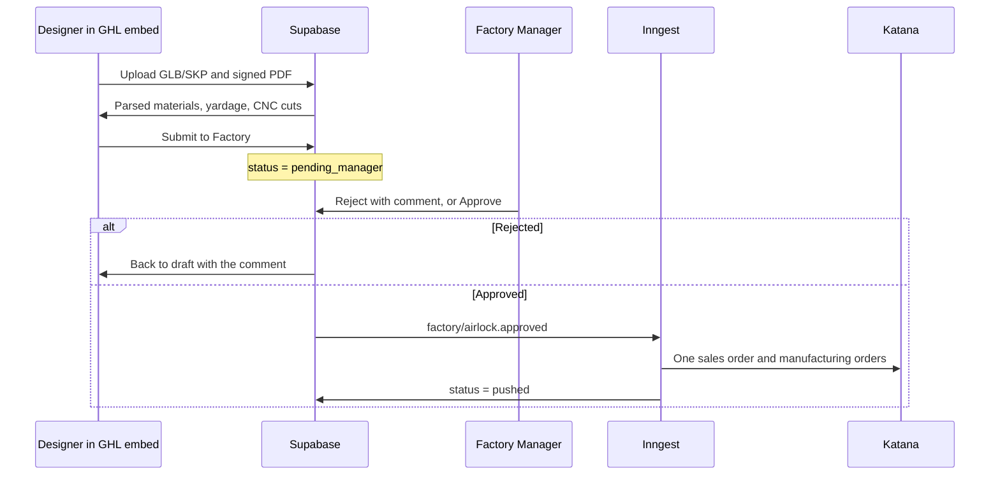

# Airlock Dual-Approval BOM Pipeline

**Status:** Blueprint. Not applied. Schema, routes, and the Inngest function are still to be built.  
**Audience:** Factory Manager / Systems Architecture  
**Binding SoT:** [`docs/MDM_MASTER_BLUEPRINT.md`](MDM_MASTER_BLUEPRINT.md) §2.4 (GHL factory orders) and §3.1 (adjacency-list BOM, Inngest, no JSONB recipe tree as the system of record).  
**Related:** [`docs/CAD_UPLOAD_PIPELINE_PLAN.md`](CAD_UPLOAD_PIPELINE_PLAN.md), [`docs/FACTORY_BOM_KATANA_UX_PLAN.md`](FACTORY_BOM_KATANA_UX_PLAN.md)  
**Date:** 2026-10-22

This document replaces the direct GoHighLevel-to-Katana webhook as the trigger for a custom CAD build. Katana receives a sales order and manufacturing order only after the Factory Manager approves the extracted BOM.

---

## Executive verdict

There is no `factory_bom_build` table. Nothing in the schema holds `draft → pending_manager → approved → rejected → pushed`.

The designer wizard at `/embed/factory-bom` can still reach Katana before a factory manager signs. Step 4 calls `publishApprovedRecipeToKatana` for catalog SKUs. Client `JOB-` pieces call `finalizeDesignAction` (hub only). Path A then creates the sales order and manufacturing order when a deposit or a management override is recorded.

`approved` is the `approved_by_factory` moment. A second status name would split the same fact.

Do not run `drizzle-kit push`. The change is a later hand-written additive migration. This blueprint was written during the QBO ledger lock and was not applied.

| Decision | Verdict |
|---|---|
| **Build record** | New header `factory_airlock_builds` plus append-only `factory_airlock_decisions`. BOM lines stay in `product_bom_draft` and `item_operations_draft`. |
| **Designer surface** | `/embed/factory-bom`. Step 4 becomes Submit to Factory. No Katana import. |
| **Manager surface** | `/admin/factory-airlock`. Real Supabase user with `user_roles.role` of `Ops_Manager` or `SuperAdmin`. |
| **Katana trigger** | Inngest event `factory/airlock.approved`, sent only after a compare-and-swap to `approved` returns a row. |
| **GHL webhook** | Stays a log of `order_intake`. It does not emit the airlock event. A deposit alone does not release a custom CAD job. |
| **Manager role** | Use existing `Ops_Manager`. There is no Factory Manager enum value. |

---

## What the schema tracks today

| Record | States today | What it is |
|---|---|---|
| `product_bom_draft`, `item_operations_draft`, `recipe_estimates_draft` | `draft_pending_review`, `edited`, `factory_approved` | Adjacency-list recipe lines. `factory_approved` copies a recipe into the hub. |
| `factory_release_gate` | `quarantined`, `released` | Per-SKU hash attestation. `released` requires `released_by`, `released_at`, and `dossier_hash`. |
| `custom_build_job_items.design_status` | `awaiting_cad`, `needs_review`, `cad_failed`, `finalized`, `released` | Designer CAD loop. `needs_review` is the designer after extract. |
| `custom_build_jobs` | no status | Opportunity header, signed-packet path, Katana ids. |
| `order_intake` | `received`, `approved`, `pushed`, `failed`, `rejected` | GHL "Produce Factory Order" FIN/FAB triage. |
| `saga_runs` (`path_a_cad`) | `PENDING` → `AWAITING_DEPOSIT` → `IN_PROGRESS` → `COMPLETED` | Katana sales order and manufacturing order run after a deposit or a management override. |

`product_intake.reject_reason` is the SketchUp catalog quarantine note. There is no manager comment log on a factory build.

Code anchors:

- Wizard: `src/app/embed/factory-bom/page.tsx`, `DesignWizard.tsx`, `steps/Step4Release.tsx`
- Airlock evaluation: `src/server/factory-bom/evaluate-airlock.ts`, `airlock.schema.ts`
- Hub finalization (zero Katana): `src/server/factory-bom/finalize-design.ts`
- Katana writer: `src/inngest/path-a-release.ts` on `path-a/release-to-production`
- Embed principal: `src/lib/pim-audit.ts` (`ghl-embed@ccpatio.com`). `ghlUserEmail` is a query-string label. `PimSession.ghl_role` is unpopulated until a verified GHL identity exists.
- Role table: `user_roles` (`SuperAdmin`, `IT_Admin`, `Ops_Manager`, `Designer`), keyed by `auth.users.id`

---

## Required workflow



1. **Ingestion (Step1Cad).** SketchUp team uploads the 3D model (`.glb` / `.skp`) and the signed PDF through the existing drag-and-drop UI. Client pieces already require a packet before Step 1 can continue (`step1AllowsContinue`).
2. **Extraction and verification (Step2Materials, Step3Operations).** The system parses the model into material counts, fabric yardage, and cut lines on the draft adjacency tables. The designer reviews that data and clicks Submit to Factory.
3. **Firewall.** The build enters `pending_manager`. The Factory Manager opens `/admin/factory-airlock`, reviews the extraction, and either rejects it (comment required, piece returns to design) or approves it.
4. **Execution.** Only the approve compare-and-swap emits `factory/airlock.approved`. The Inngest function creates the Katana sales order and manufacturing order, then moves the row to `pushed`.

---

## Schema change

Next hand-written file: `src/server/db/migrations/0059_factory_airlock.sql`, mirrored in `src/server/db/schema.ts`.

One mutable row per `custom_build_job_items` id. A rejection appends a decision and returns that same row to `draft`.

```sql
CREATE TYPE factory_airlock_status AS ENUM (
  'draft',
  'pending_manager',
  'rejected',
  'approved',
  'pushed'
);

CREATE TABLE factory_airlock_builds (
  id uuid PRIMARY KEY DEFAULT gen_random_uuid(),
  job_item_id uuid NOT NULL UNIQUE
    REFERENCES custom_build_job_items(id) ON DELETE RESTRICT,
  root_sku text NOT NULL
    REFERENCES sku_mappings(global_sku) ON UPDATE CASCADE ON DELETE RESTRICT,
  status factory_airlock_status NOT NULL DEFAULT 'draft',
  dossier_hash varchar(64),
  submitted_by text,
  submitted_at timestamptz,
  approved_by text,
  approved_at timestamptz,
  version integer NOT NULL DEFAULT 1,
  created_at timestamptz NOT NULL DEFAULT now(),
  updated_at timestamptz NOT NULL DEFAULT now(),
  CONSTRAINT factory_airlock_submitted_attested CHECK (
    status = 'draft'
    OR (submitted_by IS NOT NULL AND submitted_at IS NOT NULL)
  ),
  CONSTRAINT factory_airlock_approved_attested CHECK (
    status NOT IN ('approved', 'pushed')
    OR (
      approved_by IS NOT NULL
      AND approved_at IS NOT NULL
      AND dossier_hash IS NOT NULL
    )
  )
);

CREATE INDEX factory_airlock_builds_status_idx
  ON factory_airlock_builds (status);

CREATE TABLE factory_airlock_decisions (
  id uuid PRIMARY KEY DEFAULT gen_random_uuid(),
  build_id uuid NOT NULL
    REFERENCES factory_airlock_builds(id) ON DELETE RESTRICT,
  action text NOT NULL CHECK (action IN ('submit', 'approve', 'reject')),
  actor_email text NOT NULL,
  actor_role text NOT NULL,
  comment text,
  dossier_hash varchar(64) NOT NULL,
  created_at timestamptz NOT NULL DEFAULT now(),
  CONSTRAINT factory_airlock_reject_comment CHECK (
    action <> 'reject'
    OR (
      comment IS NOT NULL
      AND char_length(btrim(comment)) BETWEEN 10 AND 2000
    )
  )
);

CREATE INDEX factory_airlock_decisions_build_idx
  ON factory_airlock_decisions (build_id, created_at);

ALTER TABLE factory_airlock_builds ENABLE ROW LEVEL SECURITY;
ALTER TABLE factory_airlock_decisions ENABLE ROW LEVEL SECURITY;
REVOKE ALL ON factory_airlock_builds FROM anon, authenticated;
REVOKE ALL ON factory_airlock_decisions FROM anon, authenticated;
```

RLS on, grants revoked from `anon` and `authenticated`, same pattern as `saga_runs`. The app connects as the table owner via `POSTGRES_URL`.

### Legal transitions

Enforced in the server action with `UPDATE … WHERE status = $from AND version = $version RETURNING *`:

| From | To | Who | Condition |
|---|---|---|---|
| `draft` or `rejected` | `pending_manager` | Designer submit | `evaluateAirlock` returns no blocking codes |
| `pending_manager` | `approved` | `Ops_Manager` or `SuperAdmin` | Compare-and-swap returns a row |
| `pending_manager` | `rejected` | `Ops_Manager` or `SuperAdmin` | Comment of 10–2000 characters |
| `rejected` | `draft` | Designer reopens the piece | Decision history is kept |
| `approved` | `pushed` | Inngest only | Katana returned sales-order and manufacturing-order ids |

`pushed` is terminal. A later CAD upload on a released job stays the existing change-order rejection in `runCadIntake`.

---

## Component routing

### Designer view — `/embed/factory-bom`

`page.tsx` already branches: no SKU renders `IntakeWizard`; a SKU renders `DesignWizard` (Step1Cad, Step2Materials, Step3Operations, Step4Release).

Keep steps 1–3. Step 4's button becomes **Submit to Factory** and calls `submitAirlockAction`. That action writes the compare-and-swap and a `submit` decision. It does not import Katana.

Remove these two calls from the designer wizard:

- `publishApprovedRecipeToKatana` in `Step4Release` (catalog SKUs go to Katana on the designer's click today).
- `releaseCustomJobAction`, which emits `factory.custom_job.released`.

The embed principal may submit. The reported `ghlUserEmail` may be stored as a label on the decision. It is not an authorization.

### Manager view — `/admin/factory-airlock`

New operator route. It lists `status = 'pending_manager'` and reuses the materials and operations panels as read-only. Approve and Reject live only on that page.

The approval button needs a server-side role check. A hidden button in the embed is not the control.

- `getPimSession()` inside the GHL iframe is `ghl-embed@ccpatio.com`.
- `hasOverrideAuthority` already returns false for that principal. `commercialOverrideAllowed` does the same unless the session is a real user with `Ops_Manager` or `SuperAdmin`.
- Approve and reject call `supabase.auth.getUser()`, read `user_roles`, and refuse the embed principal before the compare-and-swap. The same check gates the queue page.
- Map the Factory Manager (Christian) to an existing `Ops_Manager` row in `user_roles`. Add a narrower enum value only if Ops Manager should keep freight overrides and lose this button.

---

## Inngest

`POST /api/webhooks/ghl` inserts `order_intake` and stops unless `GHL_FACTORY_ORDERS=live`. The custom CAD writer is `path-a/release-to-production`, and it returns without calling Katana unless `saga_runs.release_requested_at` was set by a customer deposit or `requestManagementOverride`.

New event, sent only when the compare-and-swap from `pending_manager` to `approved` returns a row:

```ts
{
  name: "factory/airlock.approved",
  id: inngestEventId("factory:airlock", buildId, dossierHash),
  data: {
    buildId,
    jobItemId,
    rootSku,
    ghlOpportunityId,
    dossierHash,
    approvedBy,
    version,
  },
}
```

Function `factory-airlock-release`, registered beside `pathAReleaseToProduction` in `src/inngest/functions.ts`:

1. Re-read `factory_airlock_builds`. Continue only when `status = 'approved'`, the hash matches, and `approved_by` is set. Any other status returns without a Katana call.
2. Read `GHL_FACTORY_ORDERS`. Anything other than `live` logs and leaves the row at `approved`.
3. In the same transaction as the compare-and-swap, record the Path A release request (`release_requested_at`, `release_source = 'factory_airlock'`, `release_requested_by`). The existing function no-ops without that timestamp, so the airlock approval is what writes it.
4. Call the existing Path A body: one sales order, manufacturing orders per item, `Idempotency-Key`, no delete, no rollback. On success, compare-and-swap `approved` → `pushed` and stamp the ids already stored on `custom_build_jobs` and `custom_build_job_items`.
5. A deposit webhook and `/api/webhooks/ghl` do not emit `factory/airlock.approved`. For a custom CAD job, a deposit may still be recorded, and it must not emit `path-a/release-to-production` on its own. Configured FIN/FAB triage on `/admin/order-triage` stays a separate lane.

---

## Execution order

1. Add `0059_factory_airlock.sql` and the Drizzle mirror. Apply it with the normal migrate path.
2. Add `submitAirlockAction`, `approveAirlockAction`, and `rejectAirlockAction`. Each one is a compare-and-swap plus a decision insert. Only approve calls `inngest.send`.
3. Point Step 4 at submit. Delete the Katana publish import from `Step4Release`.
4. Add `/admin/factory-airlock`, gated by `Ops_Manager` or `SuperAdmin` on a Supabase user. Give Christian that `user_roles` row if he does not have it.
5. Add `factory/airlock.approved` and register the function in `src/inngest/functions.ts`. Re-read the row before any Katana call.
6. Stop the deposit path from releasing a custom CAD job by itself. Keep `GHL_FACTORY_ORDERS` as the live/log gate on the Katana write.
7. Prove it with a `JOB-` piece: designer submit leaves `pending_manager` and zero Katana ids; a designer session calling approve returns unauthorized; the manager approve emits one event; the function writes `pushed` and the sales order id; a second delivery of the same event id does not create a second order.

---

## Guardrails carried forward

- Additive schema only. Never `drizzle-kit push`, drop tables, or wipe hub data against the live database.
- Katana is a single live tenant. A ledger or Katana failure is retried, not rolled back. Never delete a paid order.
- `GHL_FACTORY_ORDERS` defaults to `log`. `live` is the only mode in which the airlock function may call Katana.
- Mutating Katana calls send `Idempotency-Key`.
- JSONB BOM trees stay forbidden as the system of record.
